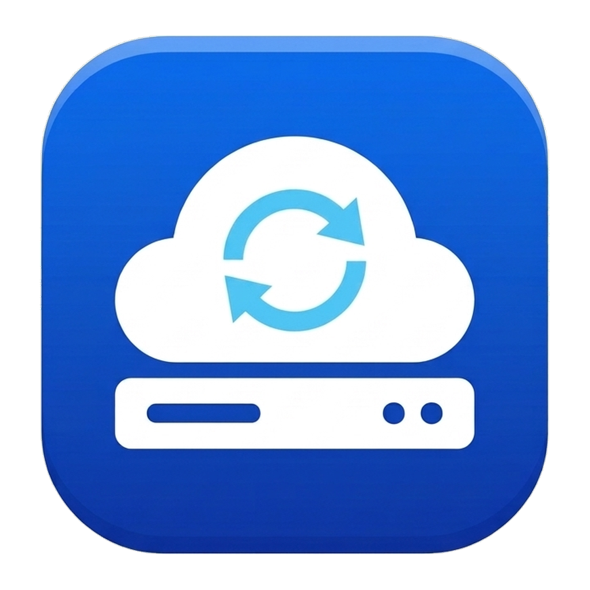

<p align="center">
  
</p>

<h1 align="center">Synology Drive Client</h1>

<p align="center">
  A lightweight cross-platform desktop sync client for Synology NAS Drive built with <strong>Tauri v2</strong>, <strong>Rust</strong>, and <strong>React</strong>.
</p>

---

## Features

- **Flexible Folder Sync**
  - Manage multiple local ↔ NAS folder pairs independently.
  - Per-folder sync modes: **Bidirectional**, **Upload-only**, and **Download-only**.
  - Optional **Sync Deletions** (moves deleted items to the recycle bin) for bidirectional and upload-only folders.
  - Atomic downloads via `.synodl-part` temporary files and automatic retry handling.
- **Secure Authentication & Session Persistence**
  - Direct Synology DSM authentication (`SYNO.API.Auth`) over **HTTPS** with strict certificate verification.
  - Built-in **2FA / OTP** challenge flow with zeroizing in-memory secret handling.
  - **Remember Login** stores only the session token and NAS metadata in the OS Credential Manager (Windows Credential Manager via `keyring`)—never passwords or OTP codes.
- **LAN Direct Transfer**
  - Optional LAN endpoint configuration with Wi-Fi SSID filtering to bypass reverse-proxy upload size limits (e.g., Cloudflare 100 MB limit) when on your local network.
- **Real-Time Watcher & SQLite State Engine**
  - Instant local file change detection (`notify`) paired with a SQLite `baseline` three-way comparison engine (`operations`, `conflicts`, `tombstones`).
  - Live operation queue, per-folder transfer progress, and a dedicated **Conflict Management** view.
- **Desktop-First Experience**
  - System tray integration (closing the window minimizes to tray instead of exiting).
  - Configurable window resolution presets, Light / Dark / System themes, and in-app documentation.
  - Desktop WebView lockdown (browser shortcuts, context menu, and accidental zoom disabled).
  - Multi-language support (`English`, `繁體中文`, `简体中文`, `日本語`).

---

## Tech Stack

| Layer | Technology |
| --- | --- |
| Desktop Runtime | [Tauri v2](https://v2.tauri.app/) (Rust) |
| Frontend | React 19, TypeScript, Vite |
| Local State | SQLite (`rusqlite` bundled) |
| File Watching | `notify` v8 |
| HTTP Client | `ureq` v3 |
| Credential Storage | `keyring` v3 (`windows-native`) |

---

## Getting Started

### Prerequisites

- **Node.js** 22+
- **Rust** stable toolchain (`rustup`)
- **Linux only:** `libwebkit2gtk-4.1-dev`, `libappindicator3-dev`, `librsvg2-dev`, `patchelf`

### Development

```bash
# Install frontend dependencies
npm ci

# Run the desktop app in development mode
npm run tauri:dev
```

### Verification & Testing

```bash
# TypeScript + Vite build + Rust cargo check
npm run check

# Run Rust unit tests
cargo test --manifest-path src-tauri/Cargo.toml
```

### Production Build

```bash
npm run tauri build
```

---

## CI/CD & Releases

GitHub Actions workflows are configured under `.github/workflows/`:

- **`ci.yml`**: Runs frontend build, `cargo check`, and `cargo test` across `ubuntu-22.04`, `windows-latest`, and `macos-latest` on pushes and PRs to `main`.
- **`release.yml`**: Builds installers for Windows (`.msi`, `.exe`), macOS (`.dmg` for Apple Silicon & Intel), and Linux (`.deb`, `.rpm`, `.AppImage`) when pushing a `v*` tag or triggering manually.

---

## Documentation

- [Security & Secrets Audit](docs/security-audit.md)
- [Multi-Language (i18n) Plan](docs/i18n-plan.md)
- [Architecture & Development Plan](docs/plan.md)
